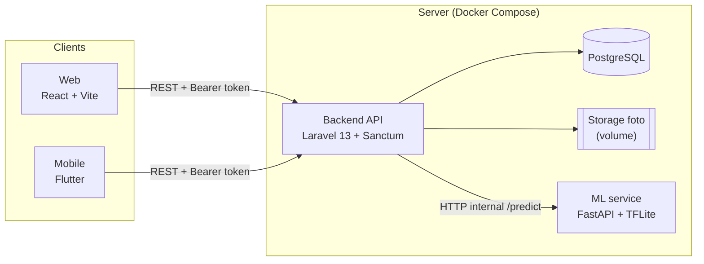
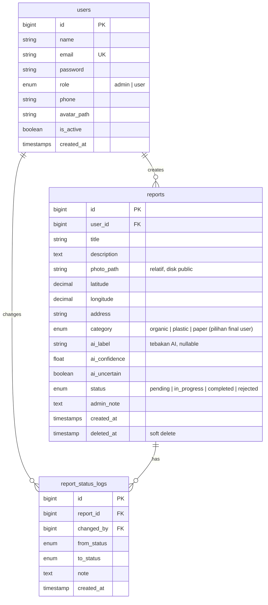
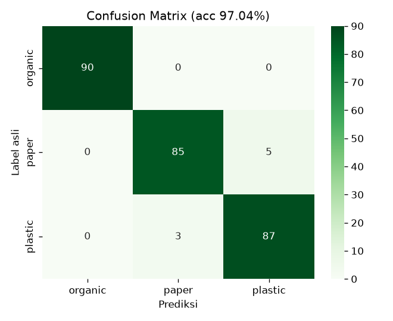
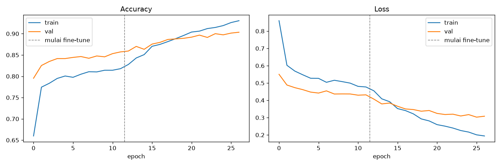

# Smart Waste Management System

Sistem pelaporan sampah berbasis AI. Warga memotret tumpukan sampah dari **aplikasi mobile atau web**. Model **machine learning**
mendeteksi jenis sampahnya (organik, plastik, kertas), lalu **admin** di dashboard web menindaklanjuti laporan sampai selesai.

| | Link |
|---|---|
| Demo website | _diisi setelah deploy_ |
| APK Android | _GitHub Releases_ |
| Video demo | _diisi_ |
| Dokumentasi API | `/docs` di backend (Scribe) · [Postman](docs/postman_collection.json) · [OpenAPI](docs/openapi.yaml) · ML: `/docs` (Swagger FastAPI) |

**Akun demo** (dari seeder): `admin@swm.test` / `password` (khusus web) · `user@swm.test` / `password`

---

## Daftar isi
- [Fitur](#fitur)
- [Arsitektur](#arsitektur)
- [Tech stack](#tech-stack)
- [Struktur repo](#struktur-repo)
- [Menjalankan secara lokal](#menjalankan-secara-lokal)
- [Database (ERD)](#database-erd)
- [API](#api)
- [Machine learning](#machine-learning)
- [Alur AI end-to-end](#alur-ai-end-to-end)
- [Testing](#testing)

---

## Fitur

**Website (admin & user)** - `web/`
- Login berbasis role, register, profil + ganti password
- Dashboard statistik: jumlah per status, per kategori, tren 7/30 hari, laporan terbaru, akurasi AI di lapangan (admin)
- CRUD laporan dengan pencarian, filter status/kategori/tanggal, urutan, pagination (filter tersimpan di URL)
- Form laporan: upload foto, **deteksi AI otomatis**, pilih lokasi di peta OpenStreetMap + alamat otomatis
- Update status laporan: Pending, In Progress, Completed, Rejected (dengan catatan dan riwayat/audit log)
- Manajemen pengguna: CRUD, filter role/aktif, aktif/nonaktif, reset password
- Peta sebaran laporan (admin), responsive (sidebar menjadi drawer, tabel menjadi kartu di layar kecil)

**Aplikasi mobile (user)** - `mobile/`
- Register dan login (akun admin ditolak di mobile)
- Dashboard ringkasan laporan milik user
- Buat laporan: foto (kamera/galeri), **AI image detection**, lokasi GPS + alamat + peta, deskripsi
- Riwayat dan detail status laporan dengan pull-to-refresh, timeline status

**Machine learning** - `ml/`
- Klasifikasi 3 kelas (organic, paper, plastic), MobileNetV2 transfer learning (TensorFlow/Keras)
- Dataset 1.800 gambar (Kaggle), **akurasi test 97,04%**, confusion matrix, classification report
- REST API prediksi dengan FastAPI (model TFLite, ringan untuk server)

**Backend** - `backend/`
- REST API Laravel + Sanctum, PostgreSQL, Policy per role, FormRequest validation, API Resource
- Proxy ke layanan ML; laporan **tetap tersimpan walau layanan ML mati**
- Seeder 30 laporan realistis dengan foto asli, dokumentasi Scribe, 32 feature test

---

## Arsitektur



- **Web dan mobile hanya berbicara ke backend.** Layanan ML tidak diekspos ke publik; backend yang meneruskan foto ke `/predict`.
- **ML dipisah jadi service sendiri** karena runtime-nya berbeda (Python vs PHP), model bisa diperbarui tanpa redeploy backend,
  dan kalau ML mati, pembuatan laporan tetap berjalan.
- Foto disimpan di disk `public` Laravel (Docker volume); database menyimpan path relatif, URL dibuat di API Resource.

## Tech stack

| Bagian | Teknologi |
|---|---|
| Backend | Laravel 13 (PHP 8.4), Sanctum, PostgreSQL, Intervention Image, Scribe, PHPUnit, FrankenPHP (Docker) |
| Web | React 19, TypeScript, Vite, TanStack Router + Query, Tailwind CSS v4, shadcn/ui, react-hook-form + zod, Leaflet (OSM), Recharts |
| Mobile | Flutter 3.38, Provider, auto_route, Dio, image_picker, geolocator + geocoding, flutter_map (OSM), flutter_secure_storage |
| ML | Python, TensorFlow/Keras (MobileNetV2), scikit-learn, FastAPI, TFLite (`ai-edge-litert`) |
| Infra | Docker, Docker Compose, nginx (web) |

## Struktur repo

```
smart-waste-management/
├── backend/            # Laravel API            → backend/README.md
├── web/                # React SPA (admin/user)  → web/README.md
├── mobile/             # Flutter app (user)      → mobile/README.md
├── ml/                 # dataset, notebook, model, FastAPI → ml/README.md, ml/dataset/README.md
├── docs/               # postman_collection.json, openapi.yaml
├── scripts/            # fetch_seed_photos.py (foto seeder dari Pexels)
├── docker/             # init script Postgres (database test)
└── docker-compose.yml  # stack dev: postgres + backend (+ ml)
```

Setiap folder punya README sendiri dengan detail instalasi, env, dan struktur kodenya.

---

## Menjalankan secara lokal

### Prasyarat
Docker (cara cepat), atau: PHP 8.4 + `pdo_pgsql`, Composer, PostgreSQL, Bun/Node 20, Flutter 3.38, Python 3.12.

### 1. Backend + database (Docker)
```bash
docker compose up -d postgres backend                 # API di http://localhost:8088
docker compose exec backend php artisan db:seed       # akun demo + 30 laporan
```
Tanpa Docker (Postgres lokal): lihat [backend/README.md](backend/README.md#menjalankan-tanpa-docker-postgres-lokal).

### 2. Layanan ML
```bash
cd ml
python3.12 -m venv .venv && .venv/bin/pip install -r requirements.txt
.venv/bin/uvicorn app.main:app --port 8001            # Swagger: http://localhost:8001/docs
```
Atau lewat Docker: `docker compose --profile ml up -d ml`. Backend membaca alamatnya dari `ML_URL`.

### 3. Web
```bash
cd web
bun install
echo "VITE_API_URL=http://localhost:8088/api/v1" > .env
bun run dev                                           # http://localhost:5173
```

### 4. Mobile
```bash
cd mobile
flutter pub get
dart run build_runner build --delete-conflicting-outputs --force-jit
flutter run                                           # default http://localhost:8000/api/v1 (adb reverse tcp:8000 tcp:8000)
flutter build apk --release --dart-define=API_BASE_URL=https://api.example.com/api/v1
```

### Environment variable penting

| Aplikasi | Variabel | Contoh |
|---|---|---|
| backend | `DB_*` | `pgsql`, `127.0.0.1`, `swm` / `secret` |
| backend | `APP_URL` | dipakai untuk URL foto `/storage/...` |
| backend | `ML_URL`, `ML_API_KEY` | `http://ml:8000` |
| backend | `CORS_ALLOWED_ORIGINS` | `https://swm.example.com` |
| web | `VITE_API_URL` | `http://localhost:8088/api/v1` |
| mobile | `--dart-define=API_BASE_URL` | default `http://localhost:8000/api/v1` |
| ml | `CONFIDENCE_THRESHOLD`, `API_KEY` | `0.6` |

### Deploy (server dengan Docker + Nginx Proxy Manager)
```bash
git clone https://github.com/Asadell/smart-waste-management.git && cd smart-waste-management
cp .env.staging.example .env.staging        # isi APP_KEY, DB_PASSWORD, ML_API_KEY, URL
docker compose -f docker-compose.staging.yml --env-file .env.staging up -d --build
docker compose -f docker-compose.staging.yml --env-file .env.staging exec backend php artisan db:seed --force   # sekali saja
```
Stack: `swm-postgres`, `swm-ml` (keduanya internal), `swm-backend`, dan `swm-web`. Backend dan web bergabung ke network
`npm_proxy`, jadi di Nginx Proxy Manager cukup arahkan domain ke `swm-backend:80` dan `swm-web:80`. Foto dan database
tersimpan di Docker volume, sehingga aman saat rebuild. Update: `git pull` lalu ulangi perintah `up -d --build`.

---

## Database (ERD)



- `category` (pilihan final user) dipisah dari `ai_label` / `ai_confidence` (tebakan AI apa adanya), sehingga akurasi AI di dunia nyata bisa diukur.
- `report_status_logs` adalah audit trail: siapa mengubah status, kapan, dari apa ke apa, dan catatannya.
- Index: `reports(status)`, `reports(category)`, `reports(user_id)`, `reports(created_at)`, `users(role)`.
- Memakai migration default Laravel ditambah migration `add_profile_fields_to_users_table`, `create_reports_table`, `create_report_status_logs_table`.

## API

Base URL `/api/v1`, autentikasi `Authorization: Bearer {token}` (Sanctum). Format response: `{ data, meta, message }`.

| Grup | Endpoint |
|---|---|
| Auth | `POST /auth/register`, `POST /auth/login`, `POST /auth/logout`, `GET /auth/me`, `PUT /auth/profile`, `PUT /auth/password` |
| Reports | `GET/POST /reports`, `GET/PUT/DELETE /reports/{id}`, `PATCH /reports/{id}/status` (admin) |
| AI | `POST /predict` (proxy ke FastAPI) |
| Dashboard | `GET /dashboard/stats?days=7\|30` |
| Users (admin) | `GET/POST /users`, `GET/PUT/DELETE /users/{id}`, `PATCH /users/{id}/toggle-active`, `PATCH /users/{id}/reset-password` |

Dokumentasi lengkap dengan contoh request/response: **`/docs`** (Scribe), [docs/postman_collection.json](docs/postman_collection.json),
[docs/openapi.yaml](docs/openapi.yaml). Layanan ML: Swagger di `{ML_URL}/docs`.

**Aturan akses** (Policy Laravel): user hanya melihat dan mengubah laporannya sendiri, dan hanya selama status masih `pending`;
admin mengakses semua laporan dan satu-satunya yang bisa mengubah status. Login dari mobile dengan akun admin ditolak (403).

## Machine learning

| | |
|---|---|
| Dataset | [Garbage Classification (12 classes)](https://www.kaggle.com/datasets/mostafaabla/garbage-classification), lisensi ODbL-1.0 |
| Mapping | `organic` = biological · `plastic` = plastic · `paper` = paper + cardboard |
| Data | 1.800 gambar (600 per kelas, duplikat dihapus via hash MD5), split 70/15/15 |
| Model | MobileNetV2 (ImageNet) + head baru, 2 tahap: head saja, lalu fine-tune 30 layer terakhir |
| **Akurasi test** | **97,04%** (Keras) · **97,78%** (TFLite, lewat kode API) · macro F1 0,9704 |
| Output | `ml/models/waste_classifier.tflite` (2,4 MB, dipakai API), `.keras` (arsip) |

| Kelas | Precision | Recall | F1 |
|---|---|---|---|
| organic | 1,0000 | 1,0000 | 1,0000 |
| paper | 0,9659 | 0,9444 | 0,9551 |
| plastic | 0,9457 | 0,9667 | 0,9560 |

<p>
  
  
</p>

Semua kesalahan terjadi antara **paper dan plastic** (kemasan plastik dan kertas mengkilap mirip secara visual).
Pada foto dunia nyata dari sumber berbeda (24 foto Pexels), akurasinya **75%** karena *domain shift*: dataset berisi objek tunggal
berlatar bersih, sementara laporan berisi tumpukan sampah di lokasi nyata. Prediksi dengan confidence < 0,6 ditandai `uncertain`
sehingga user diminta memilih kategori sendiri. Detail: [ml/README.md](ml/README.md) dan notebook
[ml/notebooks/training.ipynb](ml/notebooks/training.ipynb).

## Alur AI end-to-end

```
User memilih foto (web / mobile)
  → POST /api/v1/predict (Laravel)  → POST {ML_URL}/predict (FastAPI + TFLite)
  ← { label, confidence, uncertain, probabilities }
  → kategori terisi otomatis, user boleh mengubah (wajib memilih bila AI tidak yakin / layanan AI mati)
User mengirim laporan
  → POST /api/v1/reports (foto + GPS + deskripsi + category final + ai_label/ai_confidence)
  → backend menyimpan foto (resize + re-encode), category, dan tebakan AI terpisah
  → bila ai_label kosong, backend memanggil ML sendiri; bila ML mati, laporan tetap tersimpan
Admin di web mengubah status → riwayat status tercatat → user melihatnya di mobile (pull-to-refresh)
```

## Testing

| Bagian | Perintah | Cakupan |
|---|---|---|
| Backend | `php artisan test` (DB `swm_test`) | 32 feature test: auth, role, CRUD laporan, policy, status + log, upload, proxy ML, users, dashboard |
| Web | `bun run test`, `bun run build` | routing + typecheck |
| Mobile | `flutter analyze`, `flutter test` | parsing model API |
| ML | `pytest` | API dengan stub model (tanpa file model/TensorFlow) |

## Kredit
- Dataset: [Garbage Classification (12 classes)](https://www.kaggle.com/datasets/mostafaabla/garbage-classification) oleh Mostafa Mohamed (ODbL-1.0)
- Foto seeder: [Pexels](https://www.pexels.com) (Pexels License), daftar fotografer di `backend/database/seeders/photos/manifest.json`
- Peta: © [OpenStreetMap](https://www.openstreetmap.org/copyright) contributors
